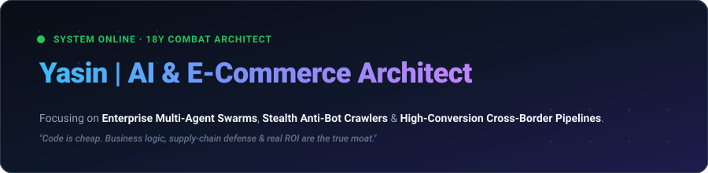

<div align="center">
  
</div>

<br/>

<div align="center">

[](https://github.com/YasinGuo520)
[](https://github.com/YasinGuo520)
[](https://github.com/YasinGuo520)
[](https://github.com/YasinGuo520)

</div>

---

### ⚡ 核心定位与作战能力 (Capabilities)

我是一名深耕一线 **18 年的电商商业操盘手与 AI 自动化系统架构师**。  
不同于只会刷算法但不懂货盘、供应链与真实转化的传统程序员，我专注于为企业和跨境品牌搭建**从数据感知、反爬情报到全自动转化的工程级闭环**。

```
┌────────────────────────────────────────────────────────────────────────┐
│                      YASIN ENTERPRISE PIPELINE                         │
├─────────────────────┬───────────────────────────┬──────────────────────┤
│  1. 商业态势与选品   │  2. 隐身情报感知中枢        │  3. 智能决策与落地交付  │
│  · 18年货盘供应链    │  · Scrapling 自适应解析    │  · 16-Agent 协同中枢   │
│  · 流量ROI与投流模型 │  · Patchright 绕过盾(CF/DD)│  · 零幻觉数据底盘      │
│  · 单元经济核算      │  · 全网高匿抓取与竞品监控   │  · 确定性兜底与自动发版│
└─────────────────────┴───────────────────────────┴──────────────────────┘
```

---

### 🛠️ 工业级技术栈矩阵 (Tech Stack)

| 领域 | 核心工具链与能力 | 交付场景 |
| :--- | :--- | :--- |
| **商业与数据感知** | `Python 3.12+` `Scrapling` `Patchright` `curl-cffi` `Playwright` | 跨境电商独立站深度数据采集、绕过 Cloudflare/DataDome 反爬、竞品价格与库存动态监控 |
| **Agent 与 AI 架构** | `Multi-Agent Orchestration` `Deterministic Fallbacks` `Pydantic` | 企业级无幻觉工作流、工单自动处理、自动化营销文案与脚本批量生成 |
| **应用与服务交付** | `FastAPI` `Vue.js` `Tailwind CSS` `Docker` `MySQL` `Redis` | 商业 SaaS 监控大屏、高可用 API 网关、自愈式定时巡检后台 |

---

### 🚀 核心工业级代表作 (Featured Repositories)

- **[stealth-ecom-radar](https://github.com/YasinGuo520/stealth-ecom-radar)**  
  *工业级自适应抗反爬·全球电商情报感知引擎* —— 结合动态指纹伪装与自适应 DOM 解析，实现对跨境电商独立站、竞品价格与库存波动的秒级静默感知，杜绝封号与 IP 污染。

---

<div align="center">
  <sub>All repositories are engineered for production stability. Asynchronous, rigorous, and results-first.</sub>
</div>
